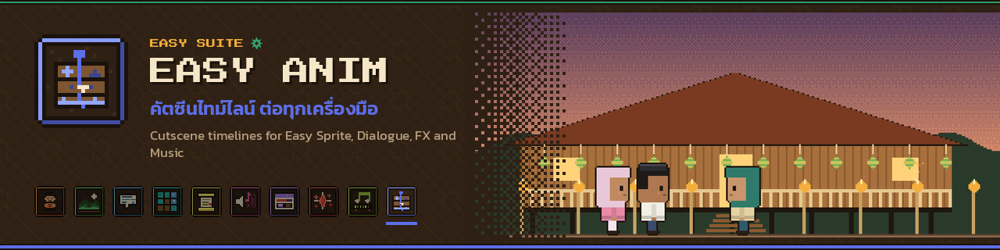
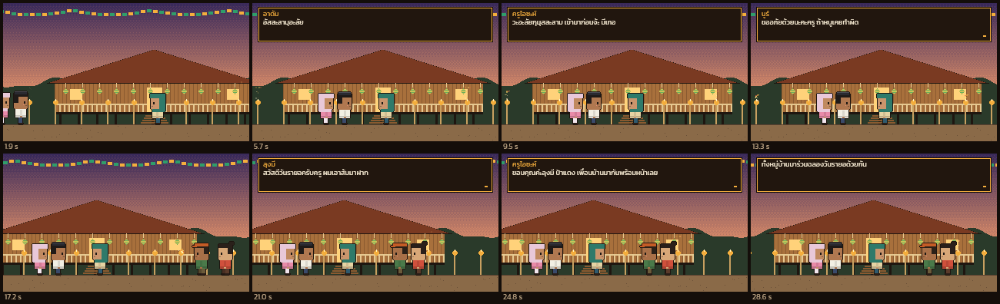
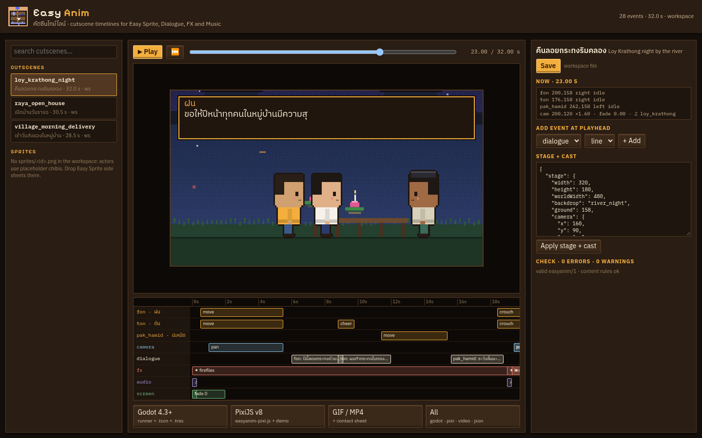

<!-- easy-suite:header:start -->
<p align="center">
  <a href="#easy-suite"></a>
</p>

<p align="center">
  <b>Easy Anim</b> · คัตซีนไทม์ไลน์ ต่อทุกเครื่องมือ · Cutscene timelines for Easy Sprite, Dialogue, FX and Music<br />
  <sub>Part of <a href="#easy-suite"><b>Easy Suite</b></a>: Thai-friendly pixel-art game dev tools for Godot 4.3+ and PixiJS v8</sub>
</p>

<p align="center">
  <a href="https://github.com/Saladin2020/easyanim/actions/workflows/ci.yml"></a> <a href="LICENSE"></a>  <a href="#export"></a> <a href="docs/MCP.md"></a> 
</p>

<p align="center">
  <a href="https://github.com/Saladin2020/easysprite"></a>
  <a href="https://github.com/Saladin2020/easyscene"></a>
  <a href="https://github.com/Saladin2020/easydialogue"></a>
  <a href="https://github.com/Saladin2020/easytilemap"></a>
  <a href="https://github.com/Saladin2020/easyquest"></a>
  <a href="https://github.com/Saladin2020/easysfx"></a>
  <a href="https://github.com/Saladin2020/easyui"></a>
  <a href="https://github.com/Saladin2020/easyfx"></a>
  <a href="https://github.com/Saladin2020/easymusic"></a>
  <a href="https://github.com/Saladin2020/easyanim"></a>
</p>
<!-- easy-suite:header:end -->

# Easy Anim

**คัตซีนสำหรับเกมพิกเซล: เดิน หันหน้า ท่าทาง กล้อง บทพูด เอฟเฟกต์ เสียง เพลง เฟด ในไทม์ไลน์เดียว**  
Write a cutscene as a small JSON timeline (`easyanim/1`): **actors** (Easy Sprite side-view characters) that move,
face and play poses, a **camera** that pans, zooms and shakes, **dialogue** lines (inline Thai/English text or an
Easy Dialogue `.ezd` ref), **FX** spawns (Easy FX ids), **SFX / music** cues (Easy SFX / Easy Music ids), fades,
waits and "press to continue" holds. Scrub it in a web editor with a live preview, then export a **Godot 4.3+**
project (a `cutscene_runner.gd` node, one `.tscn` per cutscene, `SpriteFrames` `.tres` per sheet), a **PixiJS v8**
runner, or **GIF / MP4** previews. Three samples from the shared village: a morning delivery intro, a Hari Raya
open house visit and a Loy Krathong night.

[](https://nodejs.org)

> Easy Anim **sequences · previews · exports**. It does not draw characters or generate art: actors are your Easy
> Sprite sheets (drop them in `sprites/`; missing ones render as built-in placeholder chibis), FX, sounds and music
> come from the sibling tools by id. One pure `evaluate(cutscene, t)` defines every frame; the CLI renderer, the
> editor, the Pixi runner (the same code, bundled) and the Godot runner (a GDScript port, checked against it in CI
> at 240+ sample times) all agree. **Content rules:** cutscenes never depict the Prophet or sacred figures and never
> use Quran verses or Arabic calligraphy as decoration; the cast is ordinary, multicultural villagers.

<p align="center">
  
</p>

---

## What you get

| Tracks | Samples (3) | Export |
| --- | --- | --- |
| **actor** `move` (walk/run/carry/tired speed, ease, auto facing), `face`, `anim` (15 Easy Sprite side poses), `show`, `hide` · **camera** `pan`, `zoom`, `shake` · **dialogue** `line` (Thai-safe typewriter, `.ezd` refs) · **fx** `spawn` (at a point or on an actor) · **audio** `sfx`, `music`, `music_stop` · **screen** `fade`, `wait`, `wait_input` | `village_morning_delivery` (28.5 s: Ton delivers for Pa Daeng to Kru Aisyah and Yai Kaew) · `raya_open_house` (30.5 s: Adam and Nur visit Kru Aisyah's house at Hari Raya; neighbours Lung Mee and Pa Daeng drop by; pelita and fireworks) · `loy_krathong_night` (32 s: Fon and Ton float krathong, Pak Hamid the fisherman joins; wait for input, khom loi) | Godot 4.3+ (runner, `.tscn` + `.tres`, Kanit font, demo, `test_anim.gd` parity check), PixiJS v8 (`easyanim-pixi.js` + `easyanim-core.js`, demo `index.html`), GIF + MP4 + contact sheet, normalized JSON |

<p align="center">
  
</p>

## Quick start

```bash
npm install
npm run build
npx easyanim init                      # cutscenes/ sprites/ exports/
npx easyanim list                      # 3 samples + workspace cutscenes
npx easyanim render loy_krathong_night --out loy.mp4
npx easyanim render raya_open_house --out raya.png --contact
npx easyanim serve --open              # web editor → http://127.0.0.1:8868
npx easyanim export                    # exports/easyanim-{godot,pixi,video,json}
```

`EASYANIM_HOME` (or `EASYANIM_WORKSPACE`, or `--workspace`) picks the workspace; otherwise the current folder.
Put Easy Sprite **native side sheets** in `sprites/<sprite-id>.png` (1440×144: 30 columns of 48px frames, rows
right / left / front, exported by Easy Sprite). GIF / MP4 / WebM need `ffmpeg` on `PATH` (or `EASYANIM_FFMPEG`).

<p align="center">
  
</p>

The editor plays and scrubs the cutscene with the same renderer as the CLI. Lanes: one per actor, then camera,
dialogue, fx, audio and screen; drag a block to move it in time (0.1 s snap), click the ruler to seek, add an event
at the playhead, edit any event as JSON, edit stage and cast, and see validation as you type. Save writes
`cutscenes/<id>.easyanim.json`; the export buttons run the same exporters as the CLI.

## CLI

| Command | What it does |
| --- | --- |
| `init` | create `cutscenes/`, `sprites/` (with a README) and `exports/` |
| `info` · `list [--tag t] [--json]` | workspace summary · samples and workspace cutscenes |
| `show <id>` · `state <id> --t s` | normalized cutscene · evaluated state at a time (actors, camera, fade, line, fx, music) |
| `check <id or file> [--json]` | validate (JSON path + message); exit code 1 on errors, warnings for unknown sibling ids |
| `render <id> --out f.png\|.gif\|.mp4\|.webm [--t s] [--contact] [--scale n] [--fps n] [--from s] [--to s]` | one frame, a contact sheet, or a video |
| `new <id> [--from <cutscene>] [--backdrop b] [--th] [--en] [--force]` | write `cutscenes/<id>.easyanim.json` (copy or empty template) |
| `export [ids…] [--preset godot\|pixi\|video\|json\|all] [--tag t] [--out dir] [--fps n] [--scale n]` | exports |
| `serve [--port 8868] [--dev] [--open]` | web editor + API |

## Cutscene format

```json
{
  "format": "easyanim/1",
  "th": "คืนลอยกระทงริมคลอง", "en": "Loy Krathong night by the river",
  "stage": { "worldWidth": 480, "backdrop": "river_night" },
  "actors": [
    { "id": "fon", "sprite": "side_school_girl", "name": { "th": "ฝน", "en": "Fon" }, "x": -20 },
    { "id": "pak_hamid", "sprite": "side_pelekat_fisher", "x": 440, "face": "left" }
  ],
  "events": [
    { "t": 0, "track": "screen", "op": "fade", "to": 0, "dur": 1.5 },
    { "t": 0, "track": "audio", "op": "music", "music": "loy_krathong", "fade": 2 },
    { "t": 1, "track": "actor", "op": "move", "actor": "fon", "to": [176, 158] },
    { "t": 6, "track": "dialogue", "op": "line", "speaker": "fon", "th": "กระทงของเราสวยไหม" },
    { "t": 9, "track": "fx", "op": "spawn", "fx": "krathong_glow", "at": [184, 134], "dur": 6 },
    { "t": 12, "track": "screen", "op": "wait_input" }
  ]
}
```

Times are in seconds; `dur` is optional (a move takes distance ÷ speed, a line 1.6 s + 0.06 s per character, …).
`normalize()` fills every default so runtimes read explicit values. Full reference: [docs/FORMAT.md](docs/FORMAT.md).

## Export

| Preset | Output (`exports/easyanim-<preset>/`) |
| --- | --- |
| `godot` | Godot 4.3+ project: `easyanim/cutscene_runner.gd` (`class_name EasyAnimCutscene`), `easyanim/scenes/<id>.tscn` (runner + actors + backdrop), `easyanim/sprites/<sheet>.tres` (`SpriteFrames`, animations `right`/`left`/`front`) + `.png`, `easyanim/cutscenes/<id>.json`, `easyanim/backdrops/<id>.png`, Kanit font, `main.tscn` demo, `test_anim.gd` |
| `pixi` | `easyanim-pixi.js` (`loadCutscene(PIXI, url, opts)`), `easyanim-core.js` (the TypeScript evaluator, bundled), cutscenes, backdrops, sheets, `easyanim.json`, `index.html` demo with scrubber |
| `video` | `<id>.gif` (1×), `<id>.mp4` (2×), `<id>-contact.png` |
| `json` | normalized cutscenes (every default explicit) + manifest |

The Godot runner wires the other Easy tools when they are in the project: spawns instance
`res://easyfx/scenes/<fx>.tscn` (Easy FX export), `music` calls the `MusicPlayer` autoload (Easy Music), `sfx`
calls an `SfxBank` autoload (Easy SFX) if present, and every line emits `line_shown(speaker, text, ref)` so an Easy
Dialogue box can take over. Missing pieces fall back to placeholders and signals.

```gdscript
# Godot: instance a scene, or add EasyAnimCutscene and set cutscene_path
var cs = preload("res://easyanim/scenes/raya_open_house.tscn").instantiate()
add_child(cs)
cs.finished.connect(func(): get_tree().change_scene_to_file("res://village.tscn"))
cs.waiting_for_input.connect(func(): $Hint.show())   # call cs.advance() on accept
```

```js
// PixiJS v8
import { loadCutscene } from "./easyanim-pixi.js";
const cs = await loadCutscene(PIXI, "cutscenes/village_morning_delivery.json", { music, fx, sfx: (id) => bank.play(id) });
app.stage.addChild(cs.view);
app.ticker.add((tk) => cs.update(tk.deltaMS / 1000));
cs.on("wait", () => (hint.visible = true));
cs.play();
```

`music` is an Easy Music `loadMusic()` player, `fx` an Easy FX `loadFx()` loader; both optional.

## MCP

`npm run mcp` (stdio) or `npm run mcp:http` (→ `http://127.0.0.1:8869/mcp`). Tools: `workspace_info`,
`list_cutscenes`, `get_cutscene` (with the state at `t`), `write_cutscene` (with `dryRun`), `render_cutscene`
(returns a frame or contact sheet image), `export_cutscenes`. See [docs/MCP.md](docs/MCP.md).

## Security

Local-first: the API and MCP HTTP server bind to `127.0.0.1`; any other interface needs the bearer token printed at
startup (or `EASYANIM_TOKEN`), and browser requests must come from the editor's own origin. File paths stay inside
the workspace (plus `EASYANIM_ALLOWED_DIRS`). Cutscene ids are `[a-z0-9_-]`. Nothing calls a network or paid API;
`ffmpeg` is the only external program and is only used for video.

## Development

```bash
npm run typecheck && npm test && npm run build && npm run smoke
GODOT=/path/to/godot npx vitest run test/godot.test.ts       # headless Godot: runner parity with TypeScript + playback
python3 scripts/check-pixi.py exports/easyanim-pixi           # Pixi runner in headless Chrome
npm run dev                                                   # API :8868 + Vite :5182
npm run docs:images                                           # contact sheets, key frames and the GIF in docs/assets
npm run build:core                                            # re-bundle runtime/web/easyanim-core.js after editing src/shared
```

On a box without a GPU run Godot with `GODOT_ARGS="--rendering-driver opengl3"` under `xvfb-run`.

## Easy Suite


Ten small, local-first tools that share one look (teak, lantern gold, Kanit, 16/48px pixels), one
workflow (CLI · web editor · MCP server) and the same targets (**Godot 4.3+** and **PixiJS v8**).
ชุดเครื่องมือทำเกมพิกเซลสไตล์ไทย ใช้ร่วมกันได้ทั้งชุด  
The samples share one multicultural southern Thai village: Buddhist temple, wooden kampung mosque and
Chinese-Thai shrine on the same street. หมู่บ้านพหุวัฒนธรรม วัด มัสยิด ศาลเจ้า อยู่ร่วมกันในเมืองเดียว

<!-- easy-suite:table:start -->
| | Tool | What it does | Repo |
|:-:|---|---|---|
|  | [**Easy Sprite**](https://github.com/Saladin2020/easysprite) | Compose modular 48px chibi characters (top-down + side-view) and export sheets. | [`easysprite`](https://github.com/Saladin2020/easysprite) |
|  | [**Easy Scene**](https://github.com/Saladin2020/easyscene) | Side-view levels: parallax layers, 16px autotiles, Thai town props. | [`easyscene`](https://github.com/Saladin2020/easyscene) |
|  | [**Easy Dialogue**](https://github.com/Saladin2020/easydialogue) | Branching `.ezd` dialogue with Thai-safe text, portraits and choices. | [`easydialogue`](https://github.com/Saladin2020/easydialogue) |
|  | [**Easy Tilemap**](https://github.com/Saladin2020/easytilemap) | Top-down 16px maps: blob-47 autotiles, objects, collision, spawns. | [`easytilemap`](https://github.com/Saladin2020/easytilemap) |
|  | [**Easy Quest**](https://github.com/Saladin2020/easyquest) | Text `.ezq` quests: steps, flags, items, rewards, linked to dialogue. | [`easyquest`](https://github.com/Saladin2020/easyquest) |
|  | [**Easy SFX**](https://github.com/Saladin2020/easysfx) | Deterministic 8-bit SFX and 4-channel chiptune loops, typing blips. | [`easysfx`](https://github.com/Saladin2020/easysfx) |
|  | [**Easy UI**](https://github.com/Saladin2020/easyui) | Nine-slice pixel UI kit: panels, bars, inventory, menus, 30 icons. | [`easyui`](https://github.com/Saladin2020/easyui) |
|  | [**Easy FX**](https://github.com/Saladin2020/easyfx) | Pixel particles: sparks, fire, rain, lanterns, Raya pelita; sheets + Godot particles. | [`easyfx`](https://github.com/Saladin2020/easyfx) |
|  | [**Easy Music**](https://github.com/Saladin2020/easymusic) | Seeded Thai loop music: ranat, khong wong, saw, khim, pi, kompang; seamless WAV/OGG loops. | [`easymusic`](https://github.com/Saladin2020/easymusic) |
|  | **Easy Anim** ← you are here | Cutscene timelines: actors, camera, dialogue, FX and music cues; Godot + Pixi runners. | [`easyanim`](https://github.com/Saladin2020/easyanim) |

### Works with

- **Easy Sprite** makes the actors: export native side sheets into `sprites/` and use the sheet id as `sprite`.
- **Easy Dialogue** lines: `"ref": "village_delivery.ezd#market"` keeps the cutscene in sync with your `.ezd` file; the runner emits the ref so your dialogue box can show the real node.
- **Easy FX** ids (`sparkle_shine`, `pelita_flicker`, `krathong_glow`, `khom_loi`, …) in `fx` spawns; the Godot export instances the Easy FX scenes when they are in the project.
- **Easy Music** song ids in `music` cues (`village_day`, `raya_open_house`, `loy_krathong`), **Easy SFX** ids in `sfx` cues.
- **Easy Scene** / **Easy Tilemap** levels are where a cutscene plays; **Easy Quest** steps can start one.
<!-- easy-suite:table:end -->

## Credits

Code: MIT © Salahuddin Benno. Placeholder chibis and backdrops are drawn from code (CC0). Kanit © The Kanit Project
Authors (SIL OFL 1.1) is bundled for Thai dialogue text. Easy Sprite sheets are **not** bundled (their LPC parts
carry their own licences). See [CREDITS.md](CREDITS.md).
